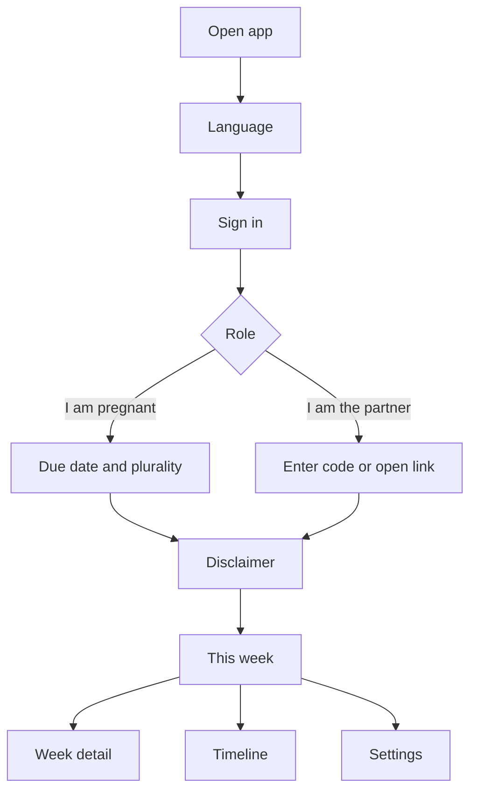
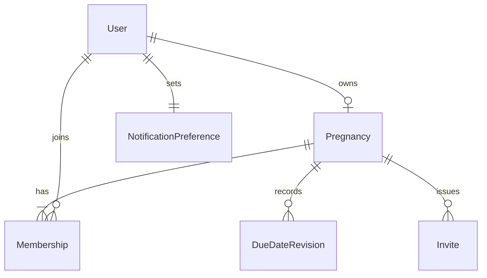

# Vita — Product Plan

**Status:** Planning draft for a US launch  
**Audience for this doc:** Founder and the 1–2 people who will design and build the MVP  
**Market:** United States, English and Spanish  
**This document is the plan.** It specifies product, content, data, and stack decisions. It does not include implementation code.

Vita (Latin for “life”) is a bilingual pregnancy companion for couples. The pregnant partner is the owner of the pregnancy. Her partner is a linked second person on the same record, with a language preference of their own.

---

## 1. Product vision and positioning

Vita helps a couple in the United States stay in the same week of pregnancy. Each week, the pregnant partner sees how the baby is developing — a familiar size comparison, an approximate length and weight, and what is forming — and the supporting partner sees how to show up that week. Either person can use English or Spanish. The tone is warm and calm, the medical claims are sourced, and the record belongs to the pregnant partner.

**Tagline (EN):** One pregnancy. Two people. Every week.  
**Tagline (ES):** Un embarazo. Dos personas. Cada semana.

**Positioning.** Vita is the week-by-week pregnancy app built for two adults who may not share a language. The development guide and the couple link are the product. Logistics (appointments, kicks, checklists, a birth plan) come after the couple is reliably sharing a week.

**Where Vita is specific**

- The partner is a full seat, with weekly “how to support her” content, not a read-only login added later.
- English and Spanish are both authored and both reviewed. Spanish is a launch language.
- The week number on screen matches what a prenatal visit will say (“16 weeks and 3 days”).
- The pregnant partner owns the record and can remove the other person in one step.
- A pregnancy can end. The app then goes quiet.

**Product principles**

1. **Same week, two seats.** Every primary screen has a reason for both roles to open it.
2. **Education with a source.** Development facts ship with a citation and a reviewer. Vita records personal logs later. Interpretation stays with the care team.
3. **Spanish is a first language of the product.** Households can be split: one person in English, the other in Spanish.
4. **She owns the pregnancy.** Dating, status, and who else has access are hers to change.
5. **Calm over completeness.** One primary card per week. A small team ships that well.
6. **A pregnancy is finite.** The app knows how to mark a birth and how to mark an ending, and it stops the weekly story in either case.

**North-star metric.** Share of onboarded pregnancies where both people open Vita during the same gestational week.

**Supporting metrics.** Seven-day return of the pregnant partner. Percent of active users whose language is Spanish. Invite-sent to invite-accepted rate. Time to correct a content error after a reviewer flags it.

**Launch geography.** The US App Store and Google Play US storefront, with English and Spanish store listings. The Mexico storefront and other countries wait. That keeps support, billing, and the medical disclaimer inside one jurisdiction. Spanish-speaking users in the US install from the US store.

---

## 2. Target personas

Vita launches with two roles. The account stores **language**, never ethnicity. National origin, immigration status, and insurance are not profile fields. Research interviews can ask those questions. The database does not.

Copy at launch addresses the pregnant partner in the feminine (“she”, “embarazada”, “acompañarla”), because that is the stated primary user. The supporting partner is always “your partner” / “tu pareja”, which covers a husband, a wife, a boyfriend, a girlfriend, or an unmarried co-parent. Vita does not ask for the partner’s gender.

### 2.1 Pregnant partner — the owner

**Who she is.** An adult in the US, pregnant with a clinician-estimated due date, or with a last menstrual period she can enter until she has one. She may be having her first baby or her third. She wants to know what this week means, and she wants her partner oriented without having to summarize every article herself.

**What she needs from Vita**

- A clear answer to “how far along am I?” that will not contradict her next visit.
- A short, trustworthy picture of the baby this week.
- Confidence that what her partner sees is accurate and kind.
- A way to stop the weekly story if the pregnancy ends or the baby is born.
- A way to remove a partner’s access immediately.

**English-speaking American context.** She is used to pregnancy apps that assume one reader, an OB on the calendar, and English. She may still want her partner more involved than those apps allow. She measures the baby the way the clinic does, usually ounces and inches, and she expects the app’s week number to match the after-visit summary. She is skeptical of cute copy that minimizes symptoms, and of apps that have shared pregnancy data with advertisers.

**US Latino and Spanish-speaking context.** She may be Spanish-preferred, bilingual, or English-preferred with Spanish at home. Those are three different product moments, and one household can contain more than one of them. Her partner’s language setting is independent of hers.

US Latinos are not one culture. Mexican-origin families are the largest group, followed by Puerto Rican, Salvadoran, Cuban, Dominican, Guatemalan, Colombian, and many others. Food words, family structure, and the Spanish they speak all differ. Vita ships **one** neutral Latin American Spanish and a locked glossary (section 6), then listens in beta for terms that fail.

Practical realities to respect in copy and in later tools:

- The due date may come from a community clinic, a certified nurse-midwife, an OB, or WIC-adjacent prenatal care. Free-text names are enough. Vita does not require an insurance portal.
- She may think of growth in centimeters and grams even though the clinic chart is in inches and ounces. Units are a per-user setting.
- Her mother may be as present as her partner. MVP still serves the couple. A third, view-only seat is a later question (section 9), not a silent assumption that the household is a couple alone.
- Privacy can be tied to household safety or to immigration stress. Vita asks for a display name and an email. It never asks for a Social Security number, a home address, or immigration status.
- Health literacy varies. Week copy targets a clear, spoken register in both languages, roughly a middle-school reading level, with clinical terms introduced in plain language (“placenta”, then a short explanation).

**Success for her.** She can tell a friend what week she is in, show her partner the same week in his or her language, and trust that the size and weight are labeled as typical ranges.

### 2.2 Supporting partner

**Who they are.** The person she invites. They may live with her or not. They may be anxious about saying the wrong thing, or they may already be the organized one. They need a job this week, not a second copy of a medical textbook.

**What they need from Vita**

- The same week number and the same baby facts she sees.
- Three short beats of support content: what is happening, one concrete way to help at home, and one way to be useful around prenatal care.
- Their own language.
- A role that cannot change her due date or invite someone else.

**English-speaking context.** Avoid the “clueless dad” joke. It insults both people, and it assumes the partner is a father. Write to a capable adult.

**Spanish-speaking context.** The same rule, stronger. Imported “papá torpe” humor is a common failure mode in translated pregnancy content. “Tu pareja” keeps the seat open for women partners and for couples who are not married. Use *tú*, which is the warm consumer register across US Latino audiences. *Usted* reads like a clinic form. *Vosotros* is Spain. *Vos* is regional and stays out of the interface.

**Success for them.** Once a week they open Vita, learn the week, and do one useful thing without being told they are behind.

### 2.3 Tone sample (not medical copy)

This shows shape and voice only. A reviewer replaces every factual sentence before it ships.

**EN, partner card, illustrative.** “This week’s guide is about how the baby is growing. Pick up one household task she usually handles, and offer to come to the next visit and take notes.”

**ES, partner card, illustrative.** “La guía de esta semana cuenta cómo va creciendo el bebé. Encárgate de una tarea de la casa que ella suele hacer, y ofrécele ir a la próxima cita para tomar notas.”

---

## 3. Feature set

**MoSCoW** describes priority. **Phase** describes when a small team builds it.

| Feature | One-line description | MoSCoW | Phase |
|---|---|---|---|
| Clinician due date and week math | Enter the due date from the care team, or a last period, and show the matching week and day. | Must | MVP |
| Week-by-week development | What is developing this week, in reviewed English and Spanish. | Must | MVP |
| Size comparison | “About the size of…” using a shared object key and a localized name. | Must | MVP |
| Length and weight ranges | Typical range for that week, labeled as typical, converted to the reader’s units. | Must | MVP |
| Couple link | The owner invites one partner with a code or link; both see the same pregnancy. | Must | MVP |
| Weekly partner support | A short “how to support her this week” card for the partner, previewed for her. | Must | MVP |
| Progress timeline | Scroll the pregnancy by week and trimester, and reopen any week. | Must | MVP |
| Per-user language | English or Spanish for each person, switchable in settings, effective immediately. | Must | MVP |
| Unit preference | Inches and ounces, or centimeters and grams, per person. | Must | MVP |
| Weekly reminder | One local notification a week with neutral copy. | Must | MVP |
| When to get care | A static, reviewed page of general reasons to contact the clinic, labor and delivery, or emergency services. | Must | MVP |
| Disclaimers and sources | In-flow disclaimer, a sources screen, and a content version. | Must | MVP |
| Owner controls | She edits the due date, removes the partner, and the partner cannot do either. | Must | MVP |
| Pregnancy status | Ongoing, baby born, or pregnancy ended, with a quiet screen after either ending. | Must | MVP |
| Download my data and delete account | Export the account’s personal data and delete it from in the app. | Must | MVP |
| Plurality flag | “One baby” or “more than one”; multiples hide singleton size and weight. | Must | MVP |
| Appointment tracker | Clinic name, date, and a note, with a reminder. Free-text location, no portal login. | Should | Phase 2 |
| Appointment reminders | Local or push reminder the day before and the morning of a visit. | Should | Phase 2 |
| Symptom log | Private-by-default notes and common symptoms, shared with the partner only if she chooses. | Should | Phase 2 |
| Kick counter | A session timer and a count she can show her clinician. The app stores the count and does not score it. | Should | Phase 2 |
| Contraction timer | Start, stop, and a list of recent intervals for a call with the clinic. The app does not declare labor. | Should | Phase 2 |
| Checklists | Hospital bag and “questions for the visit,” editable, available in both languages. | Should | Phase 2 |
| Birth preferences sheet | A one-page conversation aid for the care team, with a disclaimer that the team and the birth will shape the real plan. | Should | Phase 2 |
| Bump photo journal | Private photos, location metadata removed, visible to the partner only if she shares them. | Should | Phase 2 |
| In-app content publishing | Reviewers publish week text without an app release, with the bundled pack as fallback. | Should | Phase 2 |
| Shared notes | A short note either person can leave on the week, off by default for older weeks. | Could | Phase 2 |
| Visit summary export | A PDF of appointments and logs she can hand to the clinic. | Could | Later |
| Baby name list | A private list, including a reviewed set of names common in US Latino families, with meanings. | Could | Later |
| Weight log | Optional body-weight entries, private to her, easy to skip. | Could | Later |
| Postpartum bridge | Two to six quiet weeks after birth with sourced recovery basics, then a graceful end. | Could | Later |
| View-only supporter | A third seat (for example a mother) who can see the week and cannot see private logs. | Could | Later |
| Health-app connection | Apple Health and Health Connect for weight or kicks, after the logs themselves are solid. | Could | Later |
| Home-screen widget | Current week and days remaining. | Could | Later |
| Community or feed | People sharing pregnancy stories inside Vita. | Won't | — |
| Advertising or data sale | Ad networks, data brokers, or a social-login SDK used for advertising. | Won't | — |
| Symptom checker or diagnosis | Any screen that tells her what a symptom “is” or whether a kick count is abnormal. | Won't | — |
| AI medical chat | A bot that answers clinical questions about her pregnancy. | Won't | — |
| Telehealth, insurance, or benefits | Coverage checks, bill estimates, or a directory that implies endorsement. | Won't | — |
| Multi-country storefronts | Store listings, taxes, and disclaimers outside the United States. | Won't | — |

**Why the MVP is this small.** Week math, bilingual reviewed content, and a safe couple link are the whole promise. Appointments, kicks, contractions, photos, and a birth plan are valuable and they are also where privacy incidents and medical over-claiming happen. They wait until the couple loop works.

**Cut order if the launch date slips.** Cut timeline visual polish first, then export-file polish. Account deletion still ships. Never cut week math, either language, the couple link, partner removal, the quiet ended state, the disclaimer, or neutral notification copy.

**Phase 2 default bet.** Appointment tracker and reminders. They give the couple something to do between weekly reads, and they are safer than a contraction timer. Build the contraction timer and the kick counter in the same phase, behind the privacy rule in section 5, after the appointment loop is in users’ hands.

---

## 4. MVP screen-by-screen app flow

One app, two emphases. The pregnant partner lands on the baby. The supporting partner lands on how to help, with the baby immediately below. Vita does not ship two clients.



If the partner installs first, the join screen explains that she creates the pregnancy and sends the code. There is no reverse invite in the MVP.

### 4.1 Language

- “English” and “Español” written that way, in both languages, so a person can escape the wrong language.
- The phone language is preselected. She can change it before any other sentence appears.
- Changing language later in settings is instant and does not change her partner’s language.

### 4.2 Sign in

- Sign in with Apple, Sign in with Google, and email magic link.
- No password field.
- Age confirmation: the person states they are 18 or older. Serving pregnant minors is a legal question for counsel (section 9), not an accidental path.
- Returning users with a session skip to This week.

### 4.3 Role

- Two choices: “I’m pregnant” / “Estoy embarazada”, and “I’m the partner” / “Soy la pareja”.
- One line of reassurance: she will control the due date and who is linked.

### 4.4 Pregnancy setup (owner)

- Display name. One free-text field, full Unicode, so accents and two surnames fit. Vita does not split paternal and maternal last names.
- Due date, using the native date picker (no typed MM/DD versus DD/MM).
- Helper text: use the date the clinician gave. If she does not have one yet, she can enter the first day of her last menstrual period and Vita will estimate.
- Plurality: one baby, or more than one.
- Units: inches and ounces, or centimeters and grams. Default follows the language (English → US customary, Spanish → metric) and is easy to flip.
- The owner can edit all of this later.

### 4.5 Join (partner)

- Code field plus automatic redemption when a link is opened.
- Display name, language (already chosen), units.
- After a valid code: the pregnancy’s week, with no ability to edit the due date.

### 4.6 Disclaimer (both roles, once)

- Vita is education and a shared record. It is not medical advice, not a diagnosis, and not emergency care.
- Prenatal care belongs with her clinician, midwife, or clinic.
- Emergency symptoms belong with emergency services or labor and delivery.
- A required acknowledgment checkbox, stored with a timestamp and the disclaimer version.
- Link to the full text and to sources.

### 4.7 This week (home)

**Shared header**

- “Week 16 · day 3” / “Semana 16 · día 3”, trimester, and days until the due date.
- If the due date was edited, one quiet line: “Due date updated.”

**Pregnant partner, top to bottom**

- Hero card: size comparison, approximate length, approximate weight, one sentence on what is developing. Ranges use “about” / “aproximadamente”.
- If plurality is more than one: the hero shows the week and development text, and explains that size and weight on Vita describe a typical singleton. Her care team interprets growth for multiples.
- Primary action: open the full week.
- Secondary: timeline.
- A short preview of the partner card, titled “What your partner sees this week” / “Lo que verá tu pareja”.
- If no partner is linked: one invite card, easy to dismiss for the session.

**Supporting partner, top to bottom**

- Support card first: three short beats (what is happening, one way to help at home, one way to help around care).
- The same baby hero below it, so they still get the wonder.
- Timeline.

**Quiet states**

- Baby born: the baby’s name if she entered one, the birth date, and a short close. No size comparison.
- Pregnancy ended: a respectful acknowledgment, no week content, no size, and a link to a national perinatal mental-health resource that offers Spanish. Confirm the organization and the number at ship time. Offer delete or keep the account.
- Before week 4: a single early module, not a fake organ-by-organ week.
- Past 42 weeks: a static message to contact the care team, plus the disclaimer.

### 4.8 Week detail

- Week title, trimester, size, length range, weight range.
- “What’s developing,” in short sections (body, senses, movement — only the sections that week’s source actually supports).
- Partner support block, full text.
- Previous and next week.
- “Sources for this week.”
- A repeated one-line disclaimer in the footer of every week.

### 4.9 Timeline

- Weeks grouped by trimester. Weeks 1–3 collapse into “Early.”
- The current week is marked.
- Tapping a week opens week detail.
- Future weeks are readable. There is no lock on later weeks in the MVP. Hiding them annoys the person who was told something at a visit and wants to look it up.

### 4.10 Invite

- Share sheet with a link and a short code.
- The code expires in seven days, works once, and can be replaced.
- Copy makes clear the partner will see the week and the support guide.

### 4.11 Settings

- Language.
- Units.
- Weekly reminder on or off, and a time of day.
- People: partner’s display name, and, for the owner, “Remove partner.”
- Due date and plurality, owner only.
- Pregnancy status: still pregnant, baby is here, pregnancy has ended.
- Sources and disclaimer.
- Privacy policy and support email.
- Download my data.
- Delete account, with a plain-language confirm.
- Sign out.

### 4.12 When to get care

- A static page, written by the clinical reviewer in both languages, of general reasons to call the clinic, go to labor and delivery, or call emergency services.
- Topics the reviewer should cover, in their own sourced words: bleeding, severe headache or vision changes, signs of preterm labor, reduced fetal movement as the reviewer defines it for lay readers, fever, and thoughts of harming herself.
- The page tells her to contact a local clinician or emergency services. It does not triage.

### 4.13 What the MVP flow feels like

She installs Vita, chooses Español or English, signs in, enters the due date her midwife wrote down, and lands on this week. She sends a link. Her partner opens it on the train, in the other language, and reads three ways to help. Once a week, at the hour they each picked, their phones say only, “This week’s update is ready.” If the pregnancy ends, she marks that, the size comparisons disappear, and the notifications stop speaking as if the pregnancy were ongoing.

---

## 5. Data model outline

MVP data is small on purpose. Week prose and week facts live in the app bundle. Supabase holds accounts, the pregnancy, and membership.

### 5.1 Entities

**User profile**

| Field | Notes |
|---|---|
| `id` | Same id as the auth user. |
| `display_name` | Free text, Unicode. |
| `language` | `en` or `es`. |
| `units` | `us` or `metric`. |
| `created_at` | |

Email lives in the auth system, not in a second profile copy. Ethnicity, phone number, address, and insurance are absent.

**Pregnancy**

| Field | Notes |
|---|---|
| `id` | |
| `owner_user_id` | The pregnant partner. |
| `edd` | Estimated due date, canonical. Date only. |
| `edd_source` | `clinician` or `lmp`. |
| `lmp` | Optional. Stored when she entered a last period. |
| `plurality` | `singleton` or `multiple`. |
| `status` | `active`, `born`, or `ended`. |
| `status_changed_at` | |
| `baby_name` | Optional, used only on the born screen. |
| `disclaimer_version` | Version she accepted. |
| `disclaimer_accepted_at` | |

**Due date revision**

| Field | Notes |
|---|---|
| `pregnancy_id`, `edd`, `changed_by`, `changed_at` | A short history so support can explain a week jump after an ultrasound. |

**Membership**

| Field | Notes |
|---|---|
| `pregnancy_id`, `user_id` | Primary key. |
| `role` | `pregnant` or `partner`. |
| `joined_at` | |

One `pregnant` membership per pregnancy. One `partner` membership in the MVP.

**Invite** (not readable by the client)

| Field | Notes |
|---|---|
| `code_hash` | Store a hash, not the raw code. |
| `pregnancy_id` | |
| `expires_at` | Seven days. |
| `redeemed_at`, `redeemed_by` | Single use. |

**Notification preference**

| Field | Notes |
|---|---|
| `user_id` | |
| `weekly_enabled` | Default on. |
| `local_hour` | Default 9. |
| `timezone` | IANA name from the device. |

The device schedules the notifications. The server stores the preference so a reinstall can rebuild them.

### 5.2 Week content (bundled, not user data)

Facts are language-agnostic so English and Spanish cannot disagree about a number.

```text
content/facts/week-16.json      length and weight ranges, size_key
content/en/weeks/16.json        prose
content/es/weeks/16.json        prose
content/en/early.json           weeks 1–3
content/es/early.json
content/en/care.json            when to get care
content/es/care.json
content/glossary.json           size_key and UI terms
```

**Fact file, per completed week from 4 through 42**

- `week`
- `length_mm` as `[min, max]`
- `weight_g` as `[min, max]`
- `size_key` (for example `avocado`)
- `source_ids`

**Prose file, per week, per locale**

- `week`, `locale`
- `title`
- `developing` — list of `{ heading, body }`
- `partner_support` — exactly three `{ heading, body }` beats
- `reviewer_initials`, `reviewed_on`
- `source_ids`

**Glossary**

- `size_key` → English phrase and Spanish phrase (“an avocado” / “un aguacate”)
- Locked UI terms from section 6

Measurements are integers in millimeters and grams. The app converts and rounds for display, and always words them as approximate typical ranges.

### 5.3 Relationships



- A user has at most one active pregnancy in the MVP, either as owner or as partner.
- Deleting the owner account deletes the pregnancy, memberships, invites, and revisions.
- Removing a partner deletes that membership. The partner’s user account remains. Their home becomes: “This pregnancy is no longer shared with you.”
- Deleting a partner account removes their membership and leaves the pregnancy with the owner.

### 5.4 Week math

The due date is the source of truth. Last menstrual period is only an input that produces a due date.

- Clinician due date: store it directly.
- Last menstrual period: `edd = lmp + 280 days` (Naegele), then store that due date and the period.
- Equivalent period for math: `lmp_equivalent = edd − 280 days`.
- `gestational_days = today − lmp_equivalent`, using the device’s local calendar date. The week does not flip at UTC midnight.
- `completed_weeks = floor(gestational_days / 7)`
- `day_within_week = gestational_days mod 7`
- The on-screen week **is** `completed_weeks`, because that is the number a clinician means by “16 weeks and 3 days.”

Completed weeks 0–3 share one early module. The interface shows that module’s title, not the numeral 0.

| Local date relative to LMP equivalent | Completed week and day | What she sees |
|---|---|---|
| Day 0 | 0 weeks · day 0 | Early module |
| Day 27 | 3 weeks · day 6 | Early module |
| Day 28 | Week 4 · day 0 | Week 4 |
| Day 115 | Week 16 · day 3 | Week 16 |
| Day 280 (the due date) | Week 40 · day 0 | Week 40 |
| Day 294 | Week 42 · day 0 | Week 42 |
| Day 295 and after | Past 42 weeks | Static “contact your care team” |

Leap days use real calendar subtraction, not `280 * 24` hours, so a daylight-saving change cannot shift a week.

**Tests to write before the screens depend on it:** due date is today (week 40 day 0); due date is today plus 280 days (early module); the day-27 / day-28 boundary; the day-280 / day-281 boundary; a leap-day span; 9 p.m. Pacific still on the previous local date relative to UTC; an edited due date changes the week immediately; `multiple` hides size and weight.

### 5.5 Access rules

- A person reads and updates their own profile.
- A member reads the pregnancy. Only the `pregnant` role updates the due date, plurality, status, baby name, and membership removal.
- The partner role is read-only on the pregnancy.
- Clients cannot list invites. An edge function accepts a code and the signed-in user, checks the hash and expiry, and inserts the partner membership.
- Week content in the bundle has no user data in it.
- Product analytics, if stored, are event name, user id, role, language, and week number. Symptom text, notes, and due date stay out of analytics and out of crash reports.

### 5.6 Phase 2 entities (decide the rule now, build later)

One log model covers symptoms, kicks, contractions, appointments, checklist items, and birth-plan lines:

| Field | Notes |
|---|---|
| `pregnancy_id`, `author_user_id` | |
| `kind` | `symptom`, `kick_session`, `contraction`, `appointment`, `checklist`, `birth_preference`, `note` |
| `payload` | Kind-specific JSON. |
| `visibility` | `private` or `shared`. Default **`private`**. |
| `logged_at` | |

The partner can read a row only when `visibility` is `shared`. She opts in per item. Photos use the same rule: a private storage bucket, GPS and other location metadata stripped on upload, signed URLs, and `shared` only after she says so.

**Entitlement (when Vita Plus exists):** one row per pregnancy, not per user. A pass she buys unlocks Plus for both of them.

---

## 6. Localization strategy

### 6.1 Two layers

| Layer | Where it lives | How it is written |
|---|---|---|
| Interface | String catalogs in the app (`en`, `es`) | Product copy, ICU placeholders for counts and dates |
| Week content | Fact files plus prose files | Bilingual authoring, then clinical review **in each language** |

Runtime machine translation is out of the product. A correct English sentence can become a stronger or vaguer Spanish claim, and a small team would not see it.

### 6.2 Authoring workflow

1. Lock the glossary before drafting week 4.
2. A bilingual writer drafts English and Spanish together, from the same fact file.
3. A clinician (OB or certified nurse-midwife) reviews the facts and both prose files. Review in Spanish is its own pass, because the reviewer is checking the claim a Spanish reader will believe.
4. A second reader who is a native of a non-Mexican US Latino variety (Caribbean or Central American) flags glossary words that will confuse, without creating a second Spanish.
5. A pull request runs schema checks: every week from 4 to 42 exists in both locales, `source_ids` resolve, partner support has three beats, and no prose file contains a raw measurement that could drift from the fact file.
6. The content version on the sources screen bumps when a reviewed pack changes.

Numbers exist only in the fact file. Prose says “about the length in the card above,” or the app inserts the formatted range. That is how Vita avoids “4 ounces” in English and “4 grams” in Spanish.

**Early module and care page** go through the same review. They are short and they are the highest-risk pages.

**Sources.** Prefer US public-health references that already exist in Spanish, with the clinician’s review on top. NICHD’s pregnancy materials are a candidate starting point for the reviewer to confirm. Competitor week-by-week text is not a source. Vita does not scrape it and does not lightly rewrite it.

**Fixes after launch.** Factual corrections ship in an over-the-air update of the bundle. The sources screen shows the content version so support can ask “which version are you on?”

### 6.3 Language switching

- First screen of a new install: English and Español, device language preselected.
- Settings → Language applies immediately.
- Formatting uses `en-US` and `es-US`: dates from the native picker and from those locales (“March 12, 2026”, “12 de marzo de 2026”), decimal points consistent with US Spanish, not Spain’s decimal comma.
- The interface stays in one language at a time. Vita does not mix Spanglish in buttons and labels. Warmth belongs in the prose, not in inconsistent chrome.
- User-entered names and notes are stored as typed and never auto-translated.

### 6.4 US Latino audiences

“Spanish” is not a persona. The decisions below are how Vita stays specific without pretending one dialect fits everyone.

| Decision | What we ship |
|---|---|
| Who we ask about | Language preference only. We do not ask users to identify as Hispanic or Latino. |
| Variety | One neutral Latin American Spanish. No *vosotros*, no *voseo*, no Spain-only vocabulary (*ordenador*, *zumo*, *coger*). |
| Register | *Tú*. Short sentences. Clinical words in plain language. |
| Mexican Spanish as the center of the glossary | Mexican-origin families are the largest US Latino group, so the default term is the one most widely understood here, then checked with a Caribbean or Central American reader. |
| National variants | We do not ship `es-MX`, `es-PR`, and `es-CU` as separate products in the MVP. A term that fails beta becomes a glossary change for everyone. |
| Households | Language is per person, so she can read in Spanish while her partner reads in English. |
| Care setting | Copy says “tu médico o partera” and “tu clínica.” It does not assume a private OB, a car, or paid childcare. |
| Food and body | MVP gives no diet advice. Later nutrition content, if any, gets its own cultural review. Vita does not moralize foods. |
| Faith | Saints, prayer, and blessings stay out of the product unless a later version adds them as an explicit opt-in. Many users are religious. The default home screen is not. |
| Humor | No slapstick partner. No diminutives in navigation (*panzita*, *bebito*). “Barriga” and “bebé” are enough. |
| Names and dates | Unicode display names. Native date picker. |
| Size objects | Grocery-store objects that exist in both languages. Prefer aguacate over *palta*. Resolve *limón* in the glossary, because in much of Latin America it means lime. |
| Illustrations | Couples and pregnant bodies across a range of skin tones, including Afro-Latino and Indigenous features. Educational baby art, non-explicit. |
| Store | US storefront, Spanish listing. We do not treat “Spanish” as a reason to launch in every Spanish-speaking country. |

### 6.5 Glossary (lock these before writing weeks)

| Concept | English UI | Spanish UI | Note |
|---|---|---|---|
| App promise | One pregnancy. Two people. Every week. | Un embarazo. Dos personas. Cada semana. | Tagline |
| Pregnant role | I’m pregnant | Estoy embarazada | Feminine at launch |
| Partner role | I’m the partner | Soy la pareja | No gender |
| Partner noun | Your partner | Tu pareja | Never “your husband” / “tu esposo” as the only form |
| Support card | How to support her this week | Cómo acompañarla esta semana | Partner-facing |
| Preview of that card | What your partner sees this week | Lo que verá tu pareja | Owner-facing |
| Due date | Due date | Fecha probable de parto | Spell it out. “FPP” can appear once in a helper, not as the label |
| Week | Week 16 · day 3 | Semana 16 · día 3 | Matches the clinic |
| Trimesters | First, second, third trimester | Primer, segundo y tercer trimestre | |
| Size lead-in | About the size of an avocado | Más o menos del tamaño de un aguacate | “About” is required |
| Length and weight | About 4.5 in · about 4 oz | Unos 11 cm · unos 110 g | Examples of format only, not real week data |
| Clinician | Your doctor or midwife | Tu médico o partera | |
| Appointment | Appointment | Cita | Phase 2 |
| Kick | Kick | Patada | Phase 2 |
| Contraction | Contraction | Contracción | Phase 2 |
| Belly | Bump | Barriga | |
| Baby | Baby | Bebé | “Feto” only if a source requires the clinical word |
| Born | The baby is here | El bebé ya nació | |
| Ended | This pregnancy has ended | Este embarazo terminó | No “failed,” no “missed” |
| Emergency | Call emergency services | Llama a emergencias | Use 911 in the US body copy |
| Notification | This week’s update is ready | La guía de esta semana ya está lista | Neutral on purpose |

**String length.** Spanish runs longer. Layouts use flexible height, allow the week title to wrap, and are checked at the largest system text size. Buttons do not truncate “Fecha probable de parto.”

---

## 7. Tech stack recommendation

**Recommendation: Expo (React Native) with TypeScript, and Supabase for auth and Postgres.**

Vita’s hard problems are week math, bilingual content, privacy rules, and a couple link. They are not custom graphics. Expo lets one or two developers ship iOS and Android from one TypeScript codebase, which this launch requires together. Android matters for reaching US Latino households, so an iOS-only beta would skew who we learn from.

**Why Expo for this team**

- EAS Build produces both store binaries. EAS Update ships a factual copy fix without waiting on a full review cycle, which is the realistic way to correct educational text.
- The Supabase client, `expo-localization`, `expo-notifications`, and a standard i18n library (i18next or equivalent) cover language, sessions, and local reminders.
- TypeScript is shared between the app, the content schema checks, and a small edge function for invite codes.
- The US contractor pool for React Native is deep if the second person is hired for the beta crunch.

**Flutter** is a strong choice when the team already ships Flutter and wants pixel-identical custom drawing. Vita’s MVP is a small set of text-led screens. The extra UI control is not the bottleneck. Choose Flutter only if it is already the team’s daily tool.

### 7.1 Backend

**Supabase, US East, Postgres plus Auth plus Edge Functions.**

- A pregnancy and its members are relational. Row Level Security is the couple’s privacy boundary, and it can be tested with two users.
- Auth handles Apple, Google, and email magic link.
- One edge function redeems invite codes with elevated access, so the invites table is not world-readable.
- Storage stays unused until the photo journal. Turning it on later does not require a second vendor.
- MVP traffic fits a small paid project. Budget the paid tier before beta so backups and email limits are real.

Firebase can build this. The membership rules would be spread across documents and security rules that are harder for a two-person team to audit. Postgres keeps the model in section 5 literal.

### 7.2 Auth

- Sign in with Apple, Sign in with Google, and email magic link.
- On iOS, Apple sign-in ships in the same release as Google. App Store rules require it once another social login exists.
- No passwords in the MVP, which removes a reset flow.
- The session stays on device. A reinstall signs in again and reloads membership.

### 7.3 Notifications

**MVP: local notifications scheduled on the phone from the due date.**

- One notification per week, at the user’s chosen hour, for the weeks that remain.
- Copy is only “This week’s update is ready” / “La guía de esta semana ya está lista.”
- The size-of-a-fruit sentence stays inside the app. A scheduled notification cannot be reliably pulled off a partner’s phone the moment she marks the pregnancy ended. Neutral copy is what makes that gap safe.
- Opening the app checks `status` before it shows a week. `born` and `ended` cancel pending local notifications on that device.
- The partner’s phone cancels its pending notifications the next time it syncs. Until then, the banner is still neutral.

**Phase 2: Expo push tokens in Postgres**, sent from an edge function, for “your partner joined,” appointment reminders, and a status change that should reach the other phone promptly. Local reminders remain the fallback when push permission is denied.

### 7.4 Content management

**MVP: JSON in the repository, validated in CI, bundled in the binary.** Week pages work on an airplane after install. The network is for sign-in and membership.

**Phase 2: a `week_content` table with draft and published rows**, edited by the reviewer in a minimal password-protected page. The app reads published rows and falls back to the bundle if the network fails. A full headless CMS is extra vendor cost and an extra language for a team this size.

### 7.5 The rest of the stack

| Concern | Choice |
|---|---|
| Navigation and UI | Expo Router, a small in-house set of type, color, and spacing. System fonts. One accent. High contrast. |
| Content schema | A validator in CI (for example Zod) shared with the app’s loader. |
| Crashes | Sentry, with default PII scrubbing. No due date and no display name in the crash context. |
| Product events | A small first-party table: event name, user id, role, language, week number, timestamp. No third-party ad SDK, no Meta SDK. |
| Landing page | A static bilingual page with the privacy policy, support email, and disclaimer. Required for store listings. |
| Environments | `dev` and `prod` Supabase projects. Beta builds talk to `prod` only after the privacy policy is live. |
| Secrets | EAS secrets and Supabase secrets. Nothing private in the repo. |

### 7.6 What we are explicitly not staffing

A separate web app, a tablet layout, wearables, offline conflict resolution beyond “the bundle is complete,” and a custom illustration pipeline of 40 unique scenes. MVP art can be a small licensed or commissioned set of size-object icons plus a few warm scenes of couples, reused across weeks. Per-week original illustration is a later luxury.

---

## 8. Monetization

**Recommendation: the MVP is free. When Phase 2 tools exist, sell one Vita Plus unlock per pregnancy, as a one-time Pregnancy Pass, with a monthly option beside it.**

The week-by-week guide and the couple link are the reason someone tries Vita. Charging for them puts the differentiator behind a receipt, and it asks a couple to pay before trust exists. Advertising and data sales are a poor fit for pregnancy data and are out of the product (the Flo FTC settlement is the cautionary story: a pregnancy app sharing health data loses trust in a way that is hard to earn back).

| | Free, forever | Vita Plus |
|---|---|---|
| Who | Every couple | The pregnancy, once, for both people |
| Week-by-week guide, both languages | Yes | Yes |
| Couple link, one partner | Yes | Yes |
| Timeline, reminder, care page, export, delete | Yes | Yes |
| Appointments and reminders | | Yes |
| Symptom log, kick counter, contraction timer | | Yes |
| Checklists and birth preferences | | Yes |
| Photo journal and, later, visit PDF | | Yes |

**Price hypotheses to test, not promises.** A Pregnancy Pass in the range of $29–$39, covering that pregnancy for both people through eight weeks after the due date or the birth. A monthly plan around $5.99 for someone who does not want to pay once. Skip an annual plan at first. A pregnancy is not a twelve-month subscription habit, and a pass matches the job.

**Purchase rules**

- The owner buys. The partner is included. Entitlement hangs on the pregnancy (section 5.6).
- Restoring purchases restores the pregnancy’s Plus state for both accounts.
- Ending a pregnancy does not trigger a surprise renewal. The pass simply covers what it covered.
- Store listings say what Plus adds. They do not imply that unpaid users lack safe medical information.

**MVP launch itself has no paywall and no “Plus coming soon” nag.** A voluntary founding pass during beta is reasonable only if the clinical review needs a budget and the copy is honest that the pass is support for Vita, with Plus tools arriving in Phase 2. If that sentence is hard to say clearly, wait.

**What we measure before raising the price.** Percent of linked couples who use a Plus tool in week one of its launch, refund rate, and whether Spanish-primary couples buy at a similar rate to English-primary couples. A paywall that only English-speaking users clear is a positioning failure.

---

## 9. Risks and open questions

### 9.1 Risks

| Risk | Why it matters | What we do |
|---|---|---|
| Week number disagrees with the clinic | She will not trust anything else we show. | Clinical convention in section 5.4, plus the test list, plus due-date history. |
| Development copy is wrong in one language | Spanish readers get a different medical claim. | Facts in one file. Clinician reviews both languages. OTA correction path. |
| The app sounds like a medical device | Kick scores, “you are in labor,” or nutrition prescriptions draw FDA and store scrutiny. | Education and logs only. No interpretation layer. Counsel reviews the care page and store text. |
| App Store or Play rejection on health claims | Guideline scrutiny is higher when an app discusses pregnancy. | Citations on each week, disclaimer at onboarding and on every week, no diagnostic language, privacy policy URL, support URL, in-app account deletion. |
| Pregnancy data is sensitive even when HIPAA does not apply | A consumer app used on her own, with no clinic or insurer in the loop, is often outside HIPAA. It is still covered by FTC health-breach expectations and by state laws (California CMIA and CPRA, Washington My Health My Data, and similar laws). | Minimize fields. RLS. No ads. No data sale. Private-by-default logs later. A privacy policy in English and Spanish. A deletion path that actually deletes. |
| Someone treats Supabase marketing as a HIPAA claim | The standard Supabase project does not include a Business Associate Agreement. | We do not claim HIPAA. If counsel later says we need a BAA because a clinic is involved, that is an enterprise contract and a different architecture review. MVP has no clinic login. |
| Partner coercion or household unsafety | A linked partner who can see symptoms, photos, or location can use them against her. | MVP shares only the week guide she already previewed. She removes the partner in one step. Phase 2 logs and photos default to private. Strip photo location. Never ask for her address. |
| A loss, followed by a cheerful notification | “Your baby is the size of a papaya” after a loss is a serious harm. | Status `ended` and `born` suppress week content. Notification copy never includes size or development. |
| Multiples presented as a singleton chart | Twin growth is not a singleton chart with two labels. | Plurality question. Multiples hide size and weight and say why. |
| Trademark | “Vita” is a crowded word in food, health, and apps. | Screen the USPTO and the stores in week one, before paid branding. Be ready to ship as a distinctive wordmark (“Vita” plus a short descriptor) if the screen comes back crowded. |
| Content schedule slips | 39 weeks × two languages × development and partner copy is the critical path, not the React screens. | Writer and reviewer start the same week engineering does. Schema and two sample weeks (12 and 28) set the bar. |
| Spanish UI breaks layout | Longer strings and large text get clipped. | Flexible layouts, both languages in the beta, largest text size checked on a small phone. |
| Store review time eats the launch week | A rejection in week 12 of the plan leaves no buffer. | Submit in the launch window’s first days. Screenshots only show reviewed copy. |
| Teen pregnancy and the 18+ gate | An age gate leaves younger pregnant people out. | MVP asks the account holder to confirm they are 18 or older, which keeps COPPA and minor-consent questions out of the first release. Counsel can reopen 13–17 with a real consent design. We do not quietly collect minors’ pregnancy data. |
| Clinical reviewer unavailable | Engineering can finish and still have nothing safe to ship. | Contract the reviewer before week prose is considered final. Engineering uses clearly fake sample weeks until then. |

**Disclaimer pattern (legal should edit the words; the placement is a product decision)**

- Full acknowledgment during onboarding, versioned.
- One line in the footer of every week and on the care page.
- Store description and screenshots repeat that Vita is educational.
- Size and weight always read as typical ranges for the week, not as measurements of her baby.
- The care page is general education and tells her to reach a clinician or emergency services.

**App store health posture.** Apple’s medical and physical-harm rules and Google Play’s health policies both expect sourced information and a clear “talk to a doctor” boundary. In-app account deletion has been required by Apple since 2022 and should be treated as required on both stores. Privacy nutrition labels and the Play data-safety form should list account info and health info, and should show no tracking. If a future feature would diagnose, treat, or tell her a measurement is abnormal, stop and redesign. That feature is outside Vita’s scope.

### 9.2 Open questions

Each question has a default so the team can build while counsel or the reviewer confirms.

| Question | Default until answered |
|---|---|
| Who is the named clinical reviewer, and will they review Spanish themselves? | Contract an OB or CNM plus a bilingual perinatal educator before any week is marked final. |
| Do we license a dataset or write original prose? | Write original prose from US public-health sources. License only if the license includes Spanish and we can still edit voice. |
| Feminine copy for the pregnant partner | Keep “she” / “embarazada” at launch. “Tu pareja” stays gender-neutral. Revisit with real users if we are excluding people we mean to serve. |
| Twins and triplets | Allow the account, hide singleton size and weight, point growth questions to the care team. |
| Postpartum | A quiet “the baby is here” screen in the MVP. A short sourced recovery bridge is Later. Vita does not become a baby tracker in the first 90 days. |
| A third family seat | Later, view-only, no private logs. MVP is the couple. |
| HIPAA BAA | Not for the consumer MVP. Revisit only if a covered entity becomes a customer or a partner. |
| 18+ confirmation | On, until counsel writes a minor path. |
| Final brand and domain | Use Vita in the plan. Run the trademark screen before the public TestFlight name is advertised. |
| Support | A shared email inbox, answered in the language of the message. No in-app chat in the MVP. |
| Phase 2 first tool | Appointments and reminders, then kicks and contractions with no scoring. |

---

## 10. 90-day execution roadmap

Day 1 is the day a builder and a writer are both actually available. Content runs in parallel with engineering for the entire 90 days. If the writer starts on day 40, the launch moves.

**Team.** One or two developers. One bilingual writer (this can be a founder). One contracted clinician. A few hours of privacy-savvy counsel for the disclaimer, the privacy policy, and the age gate. No separate design sprint: visual design happens in the app, from a one-page style guide (type, spacing, accent, contrast) agreed in week one.

### Parallel content track (day 1 through day 75)

| When | Outcome |
|---|---|
| Days 1–10 | Glossary locked. Disclaimer draft with counsel. Two sample weeks (12 and 28) in English and Spanish, fact file plus prose, reviewed. This is the quality bar. |
| Days 11–45 | Weeks 4–27 drafted and reviewed, both languages. Early module and care page reviewed. |
| Days 46–70 | Weeks 28–42 drafted and reviewed. Full schema check green. |
| Days 71–75 | Beta copy fixes only. Content version frozen for submission, with OTA reserved for factual errors. |

Sample weeks used in the app before review are labeled internally and never shipped in a store build.

### Days 1–21 — Foundation

- Trademark screen started. Developer accounts (Apple, Google) confirmed. Supabase prod and dev in US East.
- Week-math module and the test list in section 5.4, done before UI binds to it.
- Auth, profiles, pregnancy, membership, RLS tests with two users, invite function.
- App shell: language screen, sign-in, both roles, disclaimer checkbox.
- Style guide in the app, checked with a long Spanish string and with the largest text size.
- Privacy policy outline sent to counsel.

**Exit.** A developer can sign in as either role on a device, create a pregnancy, join it from a second account, and see a sample week in both languages. Week-math tests are green.

### Days 22–55 — MVP build

- Setup, join, home (both emphases), week detail, timeline, invite share sheet, settings, status changes, partner removal.
- Bundle loader reading real content files as they land. Missing weeks show a calm “this week is still being prepared” only in internal builds. Store builds require the full pack.
- Local notifications, neutral copy, cancellation on status change.
- Download my data and delete account.
- Care page and sources screen.
- Static landing page with privacy policy and support email, in English and Spanish.
- Crash reporting with scrubbing. A handful of first-party events: onboarding completed, language, role, invite sent, invite accepted, week opened, status changed.

**Exit.** The journey in section 4.13 works on iOS and Android, in both languages, including born, ended, multiples, and partner removal.

### Days 56–75 — Beta

- TestFlight and Play internal testing.
- About 20 to 30 couples. At least one third are Spanish-primary on the pregnant partner’s phone. Include at least a few partners on the opposite language from the owner. Include at least a few people past week 28, so the late-pregnancy tone gets read.
- Watch the north star: do both people open the same week? Watch invite failures more than visual nits.
- Fix week-math bugs, code redemption, and copy the reviewer rejects.
- Store listings, screenshots in both languages, privacy nutrition labels, data-safety form, age questionnaire.
- Support macros in both languages for “wrong week,” “partner cannot join,” and “please delete my account.”

**Exit.** No open bug where the week number is wrong, the partner can edit the due date, or an ended pregnancy still shows a size. Content pack complete and reviewed. Policies published.

### Days 76–90 — Launch

- Submit to both US storefronts at the start of this window.
- Respond to review questions in the same week. Keep a binary ready that only changes what review asked.
- Soft launch: tell the beta couples, then a small public post in English and Spanish.
- For the first two weeks, a daily pass on crashes, support mail, and content complaints. Factual errors go out with an over-the-air update.
- Launch readout: couple overlap, seven-day return, Spanish share, invite success, top support themes.
- Choose the Phase 2 build only after that readout. The default remains appointments and reminders.

### Launch checklist

- Privacy policy and support email live in both languages.
- In-app deletion verified against a real prod user.
- Disclaimer version stored on the pregnancy.
- Every shipped week has reviewer initials, a date, and source ids in both locales.
- Notification screenshots in review notes show the neutral sentence.
- Sign in with Apple present.
- Tracking off, and the store forms say so.
- A named human owns the support inbox.

### After day 90

Phase 2 starts with the entitlement model (one Plus per pregnancy, still free for the guide) and the private-by-default log. The first tool is the appointment tracker. Kick counter and contraction timer follow with the same visibility rule and with copy a clinician has approved. Photos come after location stripping is tested. Community, AI chat, insurance tools, and a symptom interpreter stay out.

---

## Summary of decisions

| Topic | Decision |
|---|---|
| Promise | Same gestational week for two people, in the language each of them chose. |
| Owner | The pregnant partner. She can remove the partner and end the story. |
| Week number | Completed weeks since the due-date math, matching the clinic. |
| Languages | English and one neutral Latin American Spanish. Per user. |
| Measurements | One fact file in mm and g. “About” / “aproximadamente” on screen. |
| Stack | Expo + TypeScript. Supabase Auth and Postgres. Bundled JSON content. Local notifications. |
| Money | Free MVP. Later, one Pregnancy Pass per couple for the tools, not for the guide. |
| Safety | No diagnosis, no ads, no size-based push, private-by-default logs when they exist. |
| First 90 days | Both US stores, both languages, couple link, full reviewed weeks 4–42. Tools wait. |
